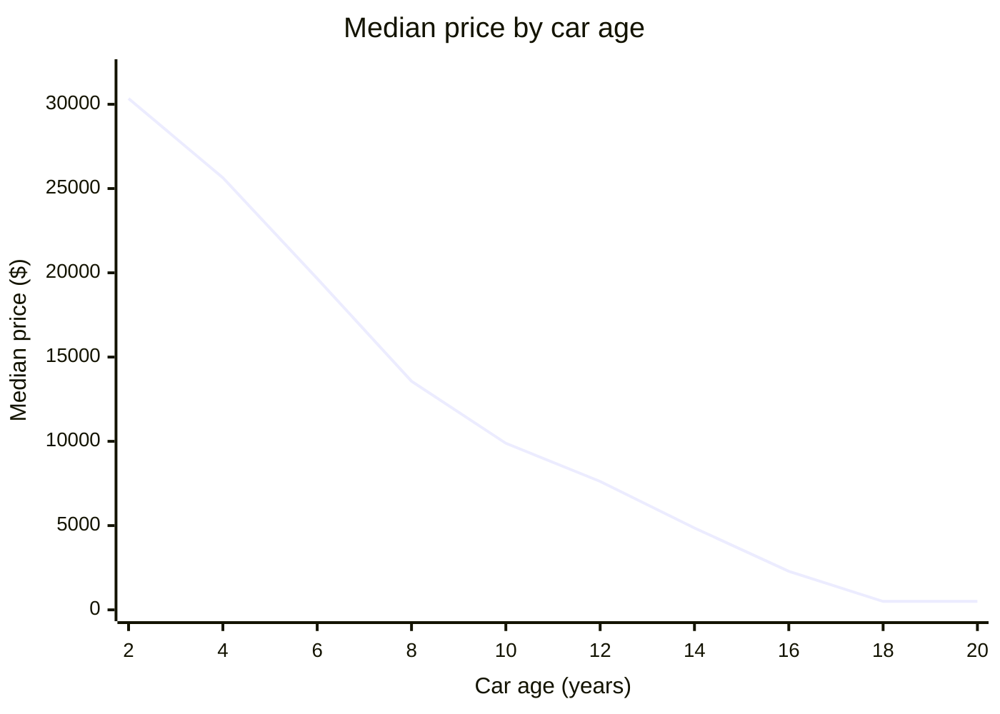
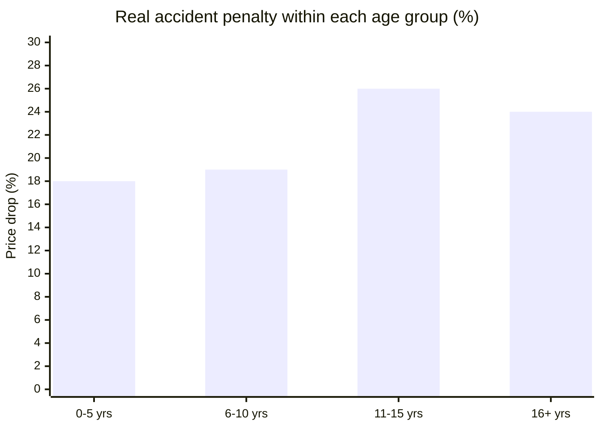
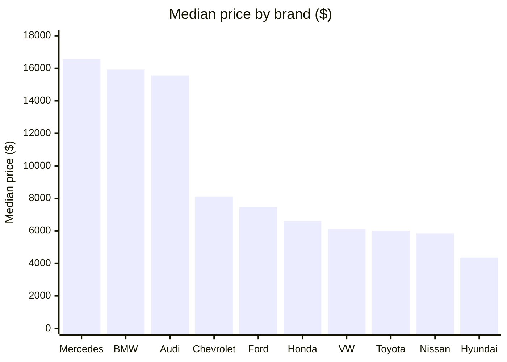

<div align="center">


# 🚗 What Really Drives the Price of a Used Car?

### An end-to-end exploratory data analysis of **5,500 used cars**, told through 4 visualization libraries


[📓 **Open the notebook**](Rahma_Ashraf_Ali_Automobile_Data_Analysis_EDA.ipynb) ·
[🔎 **View with interactive charts**](https://nbviewer.org/github/USERNAME/used-cars-price-analysis/blob/main/Rahma_Ashraf_Ali_Automobile_Data_Analysis_EDA.ipynb) ·
[💡 **Jump to the findings**](#-the-findings)

</div>

---

## ⚡ The 30-second summary

| 🚘 Cars | 🧾 Features | 🏷️ Brands | 🔧 Models | 🗑️ Rows deleted | 🎨 Viz libraries |
|:---:|:---:|:---:|:---:|:---:|:---:|
| **5,500** | **18** | **10** | **40** | **0** | **4** |

> **The one-line answer:** a used car's price is decided by **how old it is, how far it has been driven and how many hands it has passed through**. Engine power, color and even fuel type barely matter.

---

## 🎯 The mission

Used-car prices look random until you ask the right questions. This project digs into the data to answer six of them:

1. Which factors move the price the most?
2. How fast does a car lose its value?
3. How much does an accident *really* cost?
4. Do electric and hybrid cars keep their value better?
5. Do color or location change the price?
6. Are luxury brands safer for resale value?

---

## 🗺️ The journey


---

## 🕵️ Myth busters

| Common belief | Verdict | What the data says |
|---|:---:|---|
| "Age is the biggest factor in price" | ✅ **Confirmed** | Correlation with price is **-0.80**, the strongest in the dataset. |
| "Electric and hybrid cars hold their value better" | ❌ **Busted** | Within the same age group prices are almost identical (0-5 years: Electric **$26,852** vs Petrol **$26,111**). They only look pricier because they are newer. |
| "A powerful engine means a pricier car" | ❌ **Busted** | Horsepower correlates with price at just **0.06**. |
| "An accident cuts a car's price by 75%" | ❌ **Illusion** | The raw gap looks huge, but once age is controlled the real penalty is **about 18-26%**. |
| "Color and state affect the price" | ❌ **Not proven** | Differences are not statistically significant (ANOVA p = **0.16** for color, **0.44** for state). |
| "Luxury brands lose value more slowly" | 🟡 **Barely** | Brands lose between **14.4% and 16.2%** per year. Mercedes-Benz is best, Ford is worst. The gap is small. |

---

## 💡 The findings

### 1️⃣ Prices are skewed, and there is a secret floor


- Raw price is heavily right-skewed (**1.34**). A log transform fixes it (**-0.49**).
- **1,216 cars (22%) sell at exactly $500.** They are old (average year 2008), heavily driven (**238K miles**) and have had many owners (**4**), versus 2016, 79K miles and 2 owners for the rest.
- These cars were **flagged, not deleted**: they are real market behavior.

### 2️⃣ Age is king, and the first resale hurts the most



- A car loses roughly **14% of its value every year**.
- Median price falls from **$28,840** (0-3 years) to **$13,143** (6-10 years) to **$5,774** (10-15 years).
- Ownership matters too: the median drops from **$22,846** (1 owner) to **$10,764** (2 owners), losing more than half its value at the first resale. (Owners and age are strongly linked, with a correlation of **0.83**.)

### 3️⃣ The accident trap (a lesson in confounding)


A naive comparison says cars with accidents sell for **$3,481** versus **$14,119** without, a 75% drop. **That is misleading.** Cars with accidents are simply *older*: the share of cars with an accident on record grows from **5%** (0-5 years) to **50%** (16+ years).

Comparing cars **within the same age group** gives the honest answer: an accident costs about **18% to 26%**, not 75%.

### 4️⃣ Two worlds: luxury and everyone else



- Only three brands live in the premium tier: **Mercedes-Benz ($16,575), BMW ($15,940), Audi ($15,556)** (median prices).
- Every other brand has a median **below $8,200**. Hyundai is the cheapest at **$4,359**.
- Most expensive models: **E-Class ($21,171)**, **Q7 ($20,268)**, **A6 ($19,009)**. Most affordable: **Sonata ($2,064)**, **Corolla ($2,716)**, **Golf ($3,201)**.

### 5️⃣ What correlates with price, and what does not


| Factor | Correlation with price |
|---|:---:|
| Age | **-0.80** |
| Mileage | **-0.68** |
| Owners | **-0.67** |
| Torque | 0.08 |
| Horsepower | 0.06 |
| Engine size | -0.03 |

Another hidden finding: **service history is real** (cars with a full service record sell for about **$2,000 more**, p = 0.007), while color and state are just noise.

---

## 🧹 How the data was cleaned

<details>
<summary><b>Click to expand the cleaning decisions</b></summary>

<br>

About **15% of values were missing in 9 columns**, and 76% of rows had at least one gap, so deleting rows was not an option. The missing values turned out to be **random** (the highest correlation between missing patterns is only **0.033**), which makes imputation safe.

| Problem | Decision | Why |
|---|---|---|
| Missing `Horsepower`, `Torque`, `Engine_Size`, `Fuel_Efficiency` | Median per **Model + Fuel_Type** | Each model has fairly stable specs. Spread inside a group is far smaller than overall (horsepower std **34.4 vs 55.7**). |
| Missing `Accident_History` | New category **"Unknown"** | Not knowing is not the same as "no accident". |
| Missing `Service_History`, `Color`, `Location` | Category **"Unknown"** | No logical default value exists. |
| Missing `Transmission` | Most frequent value | About 76% of cars are automatic in every model, so no model-level signal. |
| `Engine_Size = 0` | **Kept** | All are electric cars, so it is a valid value. |
| Extreme mileage and electric efficiency | **Kept** | Real values, not errors. |
| 22% of cars at $500 | **Flagged** (`Price_Floor`) | Real market behavior worth tracking. |

### 🛠️ Engineered features

| Feature | How it is built |
|---|---|
| `Age` | `2026 - Year` |
| `Log_Price` | `log(1 + Selling_Price)` |
| `Mileage_per_Year` | `Mileage / Age` (usage intensity) |
| `Is_Luxury` | Mercedes-Benz, BMW or Audi |
| `Price_Floor` | 1 if the price is exactly $500 |
| `Age_Group` | 0-5, 6-10, 11-15, 16+ years |

</details>

<details>
<summary><b>📖 Data dictionary</b></summary>

<br>

| Group | Columns |
|---|---|
| Identity | `Make`, `Model`, `Year`, `Body_Type`, `Color` |
| Specs | `Fuel_Type`, `Transmission`, `Engine_Size`, `Horsepower`, `Torque`, `Drivetrain`, `Fuel_Efficiency` |
| Condition | `Mileage`, `Owners`, `Accident_History`, `Service_History` |
| Market | `Location` (US state), `Selling_Price` (USD) |

</details>

---

## 🧰 The toolbox

| Library | Used for |
|---|---|
| **Pandas · NumPy** | Cleaning, grouping, feature engineering |
| **Matplotlib** | Distributions, subplots, full control |
| **Seaborn** | Statistical plots: boxplots, violins, heatmaps, grouped bars |
| **Plotly** | Interactive scatter, treemap, parallel coordinates, US choropleth map |
| **Altair** | Linked interactive dashboard (brush a region, see the other chart update) |
| **SciPy** | ANOVA tests to separate real effects from noise |

> 💡 Plotly and Altair charts are interactive and may not render inside GitHub's notebook viewer. Use the **"View with interactive charts"** link at the top (nbviewer) or run the notebook locally.

---

## 🧱 Project structure

```
used-cars-price-analysis/
├── data/
│   └── automobile_dataset.csv
├── images/                     # banner and chart previews
├── Rahma_Ashraf_Ali_Automobile_Data_Analysis_EDA.ipynb
├── requirements.txt
├── .gitignore
└── README.md
```

---

## 🚀 Run it yourself

```bash
# 1. Clone the repo
git clone https://github.com/USERNAME/used-cars-price-analysis.git
cd used-cars-price-analysis

# 2. Install dependencies
pip install -r requirements.txt

# 3. Launch the notebook
jupyter notebook Rahma_Ashraf_Ali_Automobile_Data_Analysis_EDA.ipynb
```

---

## ⚠️ Honest notes

- The **$500 price floor** affects 22% of the data, so averages are reported as **medians** and floor-priced cars are excluded where it matters.
- Electric cars are few (**145**), so conclusions about them are less reliable, especially in older age groups.
- Imputed values add some uncertainty, although the missing data is random.
- Body type is almost fully determined by model (for example, Coupe = Mustang only), so body-type differences really reflect model differences.

## 🔭 What's next

- Predictive modeling of the selling price
- An interactive web app for price estimates

---

## 👩‍💻 Author

<div align="center">

### **Rahma Ashraf Ali Faragallah**
**Data Scientist & AI Engineer**

[](https://www.linkedin.com/in/rahma-faragallah-22b132321/)
[](https://github.com/RahmaAshrafAli-Engineer)

⭐ **If you found this useful, give the repo a star!** ⭐

© 2026 Rahma Ashraf Ali Faragallah. All rights reserved.

</div>
